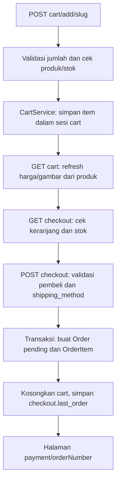
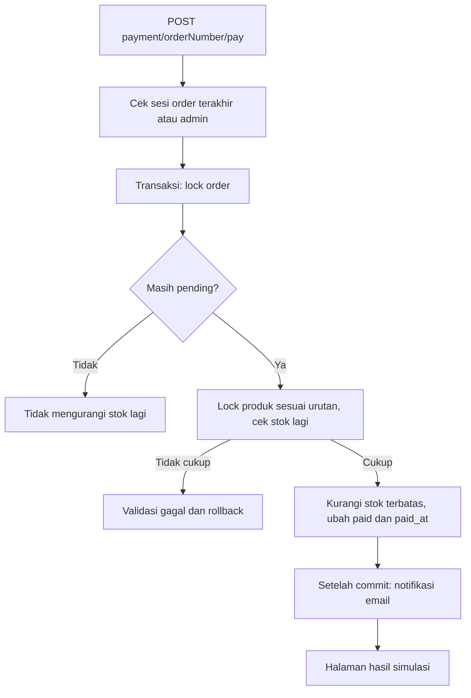

# Alur TIGAC

## Laravel dan halaman Blade

TIGAC adalah aplikasi Laravel dengan rendering Blade di server. [routes/web.php](../routes/web.php) menghubungkan halaman publik, mutasi keranjang/pesanan dan area admin. Ini bukan frontend SPA yang memanggil API toko terpisah.

| Alur | Sumber utama |
| --- | --- |
| Beranda dan konten publik | [HomePageController](../app/Http/Controllers/HomePageController.php), controller konten dan [template frontend](../resources/views/pages/frontend) |
| Katalog /product serta detail /product/{slug} | [ProductController](../app/Http/Controllers/ProductController.php), [ProductService](../app/Services/ProductService.php), [ProductRepository](../app/Repositories/ProductRepository.php) |
| Keranjang /cart | [CartController](../app/Http/Controllers/CartController.php) dan [CartService](../app/Services/CartService.php) |
| Checkout dan pembayaran | [CheckoutController](../app/Http/Controllers/CheckoutController.php), [PaymentController](../app/Http/Controllers/PaymentController.php) |
| Pencarian pesanan /cek-pesanan | [OrderLookupController](../app/Http/Controllers/OrderLookupController.php) |
| Administrasi pesanan | [AdminOrderController](../app/Http/Controllers/AdminOrderController.php) dan [Order](../app/Models/Order.php) |

Katalog mengambil produk, kategori, varian, gambar dan ulasan dari model/database. Query q/category pada katalog menghasilkan daftar terfilter dengan pagination. Detail mengambil produk melalui slug dan mengambil approvedReviews untuk penilaian yang ditampilkan. Slug yang tidak ditemukan menghasilkan HTTP 404 sebelum relasi ulasan diakses. Konten bukan data JSON statis atau katalog yang diambil dari payment gateway.

## Keranjang dan checkout

CartService menyimpan product_id, nama, slug, harga, jumlah dan gambar pada sesi Laravel dengan key cart. Controller membatasi jumlah 1–99 dan memeriksa stok pada tambah/perbarui. PUT mengubah jumlah satu produk; DELETE item menghapus baris, sedangkan DELETE cart mengosongkan keranjang.

Sebelum menampilkan keranjang/checkout, refreshProducts mengambil kembali harga dan tampilan produk. Checkout memeriksa produk yang sudah hilang atau stok tidak cukup. Data pembeli, alamat, catatan dan metode pengiriman divalidasi; ongkos berasal dari [config/shipping.php](../config/shipping.php), bukan request harga pengguna atau API kurir.

POST checkout membuat order pending beserta snapshot item dalam transaksi database. Keranjang baru dibersihkan setelah transaksi selesai. Stok belum dicadangkan atau dikurangi pada tahap ini. Nomor order disimpan dalam sesi checkout.last_order untuk mengakses halaman pembayaran.

## Pembayaran simulasi dan status

[PaymentController](../app/Http/Controllers/PaymentController.php) mengizinkan akses berdasarkan checkout.last_order atau is_admin, bukan sekadar mengetahui nomor order. [OrderLookupController](../app/Http/Controllers/OrderLookupController.php) dapat memulihkan akses sesi melalui pasangan nomor order dan email yang cocok. Rute checkout, lookup dan bayar mempunyai throttle masing-masing.

Pembayaran ulang pada order yang sudah bukan pending tidak mengurangi stok lagi. Jika satu item kekurangan stok, transaksi tidak melanjutkan perubahan stok/status. null pada stok berarti produk tidak memakai batas stok numerik. Order cancelled tidak dapat dibayar melalui alur ini. Tidak ada bank, kartu, penagihan atau transfer uang nyata.

Admin tidak melunasi order melalui dropdown status. [Order::allowedNextStatuses](../app/Models/Order.php) mengizinkan pending dibatalkan; paid dapat menuju processing/shipped/completed, processing menuju shipped/completed, dan shipped menuju completed. Status akhir tidak memiliki langkah berikutnya. Refund/pembatalan setelah paid belum menjadi alur aplikasi.

Docker menetapkan mail log, sehingga email termasuk reset password tidak dikirim lewat SMTP. Lihat [README](../README.md) untuk batas simulasi dan cara menjalankan lingkungan lokal.

## Auth dan CMS

[FortifyServiceProvider](../app/Providers/FortifyServiceProvider.php) memasang tampilan login/register/reset beserta action Fortify. [CreateNewUser](../app/Actions/Fortify/CreateNewUser.php) memvalidasi input dan membuat hash password; registrasi publik tidak menetapkan is_admin. Rute admin memerlukan auth dan [EnsureAdmin](../app/Http/Middleware/EnsureAdmin.php). Pemberian hak admin dilakukan melalui command yang dijelaskan di README.

CMS mempertahankan lapisan controller/request, service dan repository; [RepositoryServiceProvider](../app/Providers/RepositoryServiceProvider.php) menghubungkan kontrak repository ke implementasi. Contohnya ProductController menerima ProductRequest/ProductUpdateRequest dan meneruskan data ke ProductService/ProductRepository. Template [resources/views/pages/admin](../resources/views/pages/admin) menyajikan daftar, formulir dan pesan hasil.

Pada pembuatan produk, storeProductData membuka transaksi untuk produk, relasi gambar dan varian. File gambar ditulis ke disk default yang ditetapkan saat operasi dimulai. Nilai store yang false/kosong dianggap gagal. Kegagalan persistence diteruskan kembali ke controller setelah upaya rollback, sehingga controller menampilkan error dan kembali ke formulir, bukan mengumumkan simpan berhasil.

File upload berada di luar transaksi database. Service mencatat hanya path baru milik operasi ini. Pembersihan file tersebut dibolehkan jika rollback yang masih aktif mengembalikan tingkat transaksi awal, dengan keadaan PDO yang sesuai, dan commit belum pernah dicoba. File lain tidak ikut dihapus. Sesudah commit dicoba, error konfirmasi dapat terjadi meskipun database sudah menerima transaksi; file dipertahankan pada kondisi ini maupun rollback yang tidak dapat dipastikan. Kegagalan cleanup dicatat secara umum dan tidak menggantikan exception persistence asli. Alur update/delete produk tetap terpisah dari pemulihan pembuatan ini.

[tests/Feature](../tests/Feature) berisi pengujian publik/auth, akses admin, CMS, upload/newsletter dan checkout/payment; [OrderStatusTest](../tests/Unit/OrderStatusTest.php) memeriksa transisi status. [ProductFailureTest](../tests/Feature/ProductFailureTest.php) menguji detail 404, rollback insert nyata dan pesan hasil simpan admin. [ProductUploadRecoveryTest](../tests/Feature/ProductUploadRecoveryTest.php) memakai PDO SQLite dan storage fixture untuk rollback bertingkat, disk default, file store yang gagal, kegagalan cleanup/log, commit yang berhasil sebelum error konfirmasi, dan rollback yang tidak pasti. Verifikasi terakhir: 67 tes /461 asersi lulus pada PHP 8.5.12, SQLite `:memory:`, tanpa database privat atau pengiriman email.
